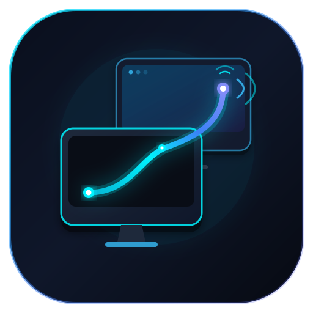
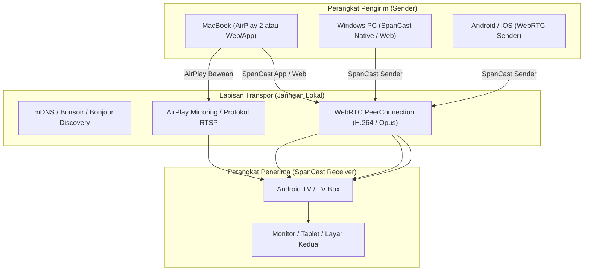

<div align="center">



# SpanCast

### Ekosistem Berbagi Layar & Layar Kedua (Desktop Spanning) Universal dengan Latensi Sangat Rendah
**Perluas, Cerminkan & Siarkan Layar Tanpa Batas di Android TV, macOS, Windows, Linux, iOS & Web**

[](README.md)
[](README.tr.md)
[](README.id.md)

[](https://spancast.yasinemreturhan.com)
[](https://spancast.yasinemreturhan.com)
[](https://webrtc.org)
[](https://developer.apple.com/airplay/)
[](LICENSE)

[🌐 Klien Web & Situs Unduhan](https://spancast.yasinemreturhan.com) • [🚀 Memulai Cepat](#-panduan-memulai-cepat) • [📐 Arsitektur](#-arsitektur--teknologi) • [📥 Unduhan](#-unduhan--platform)

</div>

---

## 💡 Apa itu SpanCast?

**SpanCast** adalah solusi open-source, universal, dan berlatensi sangat rendah untuk berbagi layar dan memperluas layar desktop (Desktop Spanning) yang mendobrak batasan ekosistem eksklusif seperti Apple AirPlay, Google Cast, dan Miracast.

Apa pun perangkat Anda (Android TV, Mac, Windows, iPhone, atau Linux), dengan SpanCast Anda dapat:
1. **Gunakan Sebagai Monitor Kedua:** Ubah Android TV atau tablet Anda menjadi monitor kedua nyata (Desktop Extension) untuk komputer Anda.
2. **Penerima AirPlay 2 Bawaan (AirPlay Receiver):** Cerminkan layar atau perluas tampilan dari Mac dan iPhone **tanpa memasang aplikasi tambahan** di Mac/iPhone, langsung melalui menu sistem AirPlay.
3. **Latensi Sangat Rendah (Ultra-Low Latency):** Berkat pipeline video WebRTC P2P dengan akselerasi perangkat keras, nikmati transmisi mulus 16-35 ms dengan sinkronisasi audio-video sempurna.
4. **Pembaruan Otomatis Dalam Aplikasi:** Perbarui ke versi terbaru langsung dari dalam aplikasi hanya dengan satu klik.

---

## ✨ Fitur Utama

- 📺 **Dioptimalkan untuk Android TV / Google TV:**
  - Antarmuka layar penuh yang 100% kompatibel dengan remote kontrol (D-Pad).
  - Dekode dan rendering video H.264/VP8 terakselerasi perangkat keras di latar belakang.
- 🍏 **Penerima AirPlay 2 Bawaan (AirPlay Server):**
  - Perangkat Android Anda langsung terdeteksi sebagai perangkat AirPlay resmi di jaringan lokal.
  - Opsi "Perluas Tampilan" di macOS langsung berfungsi sebagai monitor sekunder virtual.
- ⚡ **WebRTC P2P & Mode Zero-Playout Delay:**
  - Optimalisasi buffer jitter dan zero-playout delay untuk respon maksimal saat bekerja, menonton video, atau bermain game.
  - Streaming audio sistem tersinkronisasi penuh dengan video (AV lip-sync).
- 🔒 **Pemasangan LAN Aman (Zero-Knowledge PIN Proof):**
  - Kode QR dinamis dan 6 digit PIN di layar alur alih.
  - PIN tidak pernah dikirimkan dalam bentuk teks terbuka di jaringan (HMAC-SHA256 Challenge/Response).
  - Penyimpanan token perangkat tepercaya (Trust Token) untuk koneksi instan berikutnya.
- 🔄 **Pembaruan Otomatis Dalam Aplikasi (In-App Self-Updater):**
  - Notifikasi pembaruan otomatis saat aplikasi dibuka atau melalui tombol periksa manual.
  - APK diunduh langsung dan diluncurkan ke penginstal sistem Android bawaan (`FileProvider`).
- 🌐 **Klien Web Tanpa Perlu Instalasi:**
  - Bagikan layar langsung dari browser modern (`Chrome`, `Edge`, `Safari`) tanpa memasang perangkat lunak apa pun di sisi pengirim.

---

## 📥 Unduhan & Platform

| Platform | Format | Status | Tautan Unduhan |
|---|---|---|---|
| **Android / Android TV** | APK (v0.1.0) | Stabil | [SpanCast.apk](https://spancast.yasinemreturhan.com/SpanCast.apk) |
| **macOS (Apple Silicon & Intel)** | ZIP / App | Stabil | [SpanCast-macOS.zip](https://spancast.yasinemreturhan.com/SpanCast-macOS.zip) |
| **Windows (x64)** | ZIP / Exe | Stabil | [SpanCast-Windows-x64.zip](https://spancast.yasinemreturhan.com/SpanCast-Windows-x64.zip) |
| **Klien Web** | WebRTC Client | Aktif | [spancast.yasinemreturhan.com](https://spancast.yasinemreturhan.com) |

---

## 📐 Arsitektur & Teknologi



### Tumpukan Teknologi (Tech Stack)

- **Frontend / TV UI:** Flutter 3.x (Material 3 Dark Theme, TV Focus Engine)
- **Video & Transpor:** WebRTC (`flutter_webrtc`, LibWebRTC C++ Core), MediaProjection API, Virtual Display
- **Mesin AirPlay 2:** Server penerima AirPlay RTSP/FairPlay berbasis Java/Kotlin tertanam
- **Penemuan Layanan (Discovery):** mDNS / DNS-SD (`bonsoir` + Native Android NsdManager)
- **Infrastruktur Web & Pembaruan:** Caddy v2, TLS/Let's Encrypt, Cloudflare DNS

---

## 🚀 Panduan Memulai Cepat

### Menyiapkan Lingkungan Pengembangan

```bash
# Klon repositori
git clone https://github.com/yasinemreturhan/SpanCast.git
cd SpanCast

# Pasang dependensi Flutter
cd app
flutter pub get

# Jalankan pengujian unit
flutter test

# Bangun file release APK untuk Android TV / Mobile
flutter build apk --release

# Bangun aplikasi desktop macOS
flutter build macos --release

# Bangun aplikasi Windows
flutter build windows --release
```

---

## 🛡️ Keamanan & Privasi

- **Prioritas Jaringan Lokal (Local LAN First):** Semua lalu lintas video dan audio mengalir secara langsung antar perangkat di jaringan lokal Anda (P2P). Tidak ada streaming video yang dikirim ke server luar atau cloud.
- **Komunikasi Terenkripsi:** Koneksi WebRTC dienkripsi ujung ke ujung menggunakan standar DTLS-SRTP.
- **Perlindungan Terhadap Brute-Force:** Dilengkapi pembatasan laju percobaan (rate-limiting) dan pemblokiran IP untuk mencegah tebakan PIN secara acak.

---

## 📄 Lisensi

Proyek ini dilisensikan di bawah [Lisensi MIT](LICENSE). Lihat berkas `LICENSE` untuk informasi lebih lanjut.
