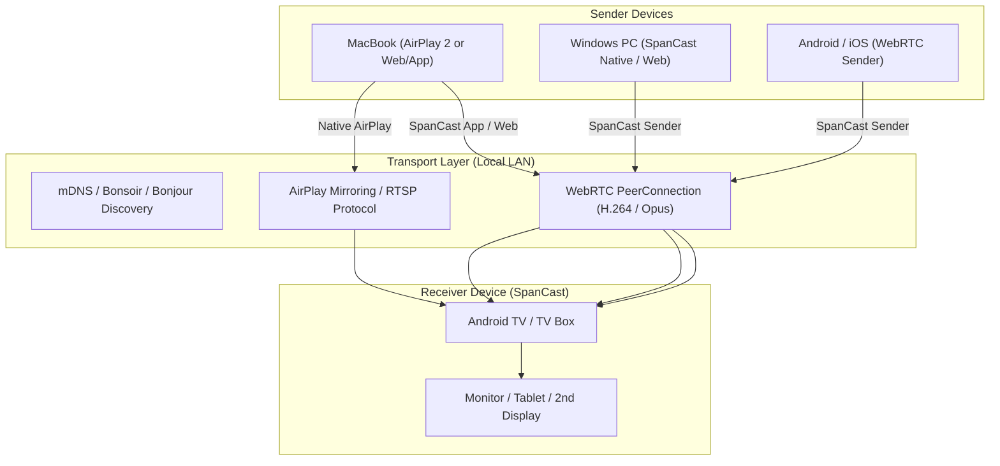

<div align="center">


# SpanCast

### Universal Ultra-Low Latency Screen Sharing & 2nd Display Ecosystem
**Extend, Mirror & Cast without Boundaries across Android TV, macOS, Windows, Linux, iOS & Web**

[](README.md)
[](README.tr.md)
[](README.id.md)

[](https://spancast.yasinemreturhan.com)
[](https://spancast.yasinemreturhan.com)
[](https://webrtc.org)
[](https://developer.apple.com/airplay/)
[](LICENSE)

[🌐 Web Client & Downloads](https://spancast.yasinemreturhan.com) • [🚀 Quick Start](#-quick-start) • [📐 Architecture](#-architecture--technology) • [📥 Downloads](#-downloads--platforms)

</div>

---

## 💡 What is SpanCast?

**SpanCast** is an open-source, universal, ultra-low latency screen sharing and virtual second screen expansion (Desktop Spanning) solution that dismantles proprietary walled gardens like Apple AirPlay, Google Cast, and Miracast.

Regardless of your devices (Android TV, Mac, Windows, iPhone, or Linux), SpanCast enables you to:
1. **Use as a True 2nd Display:** Turn your Android TV, tablet, or secondary computer into a virtual second monitor (Desktop Extension) without extra cables or hardware dongles.
2. **Native Apple AirPlay 2 Receiver:** Cast or extend displays from Mac and iPhone **without installing any third-party app** on macOS/iOS, using the native system AirPlay menu directly.
3. **Ultra-Low Latency P2P:** Enjoy 16-35 ms responsive video streaming powered by hardware-accelerated WebRTC pipelines with sub-frame synchronization and synchronized system audio.
4. **In-App Self-Updater:** Automatically notify, download, and install new versions directly within the application with one click.

---

## ✨ Key Features

- 📺 **Android TV & Google TV Optimized:**
  - 100% remote control (D-Pad) compatible full-screen receiver interface.
  - Background hardware-accelerated H.264/VP8 video decoding and rendering.
- 🍏 **Built-in AirPlay 2 Receiver (AirPlay Server):**
  - Your Android TV or Android device instantly advertises itself on the local network as an official AirPlay destination.
  - macOS "Extend Display" natively treats your TV as a second virtual desktop monitor.
- ⚡ **WebRTC P2P & Zero-Playout Delay Mode:**
  - Zero-playout delay and adaptive jitter buffering tailored for work, presentations, gaming, and fluid multimedia playback.
  - Full lip-sync system audio pass-through (Opus codec).
- 🔒 **Secure Local Pairing (Zero-Knowledge PIN Proof):**
  - Dynamic on-screen QR code and 6-digit PIN.
  - PIN is never sent in plaintext over the network (HMAC-SHA256 Challenge/Response verification).
  - Persistent Trust Tokens for seamless zero-prompt re-connections between paired devices.
- 🔄 **In-App Self-Updater:**
  - Automated version checking on startup and manual "Check for Updates" button in the AppBar.
  - In-app download with download progress bar (`MB / MB` and `%`), directly launching Android's system `PackageInstaller` via native `FileProvider`.
- 🌐 **Zero-Install Web Client:**
  - Share screens directly from any modern web browser (`Chrome`, `Edge`, `Safari`) without installing any software on the sender machine.

---

## 📥 Downloads & Platforms

| Platform | Format | Status | Download Link |
|---|---|---|---|
| **Android / Android TV** | APK (v0.1.0) | Stable | [SpanCast.apk](https://spancast.yasinemreturhan.com/SpanCast.apk) |
| **macOS (Apple Silicon & Intel)** | ZIP / App | Stable | [SpanCast-macOS.zip](https://spancast.yasinemreturhan.com/SpanCast-macOS.zip) |
| **Windows (x64)** | ZIP / Exe | Stable | [SpanCast-Windows-x64.zip](https://spancast.yasinemreturhan.com/SpanCast-Windows-x64.zip) |
| **Web Client** | WebRTC Client | Live | [spancast.yasinemreturhan.com](https://spancast.yasinemreturhan.com) |

---

## 📐 Architecture & Technology



### Technology Stack

- **Frontend & TV UI:** Flutter 3.x (Material 3 Dark Theme, TV Focus Engine)
- **Video & Transport:** WebRTC (`flutter_webrtc`, LibWebRTC C++ Core), MediaProjection API, Virtual Display
- **AirPlay 2 Engine:** Embedded Java/Kotlin AirPlay RTSP/FairPlay receiver engine
- **Discovery:** mDNS / DNS-SD (`bonsoir` + Native Android NsdManager)
- **Web & Update Infrastructure:** Caddy v2, TLS/Let's Encrypt, Cloudflare DNS

---

## 🚀 Quick Start

### Development Environment Setup

```bash
# Clone the repository
git clone https://github.com/yasinemreturhan/SpanCast.git
cd SpanCast

# Fetch Flutter dependencies
cd app
flutter pub get

# Run unit tests
flutter test

# Build release APK for Android TV & mobile
flutter build apk --release

# Build macOS desktop application
flutter build macos --release

# Build Windows desktop application
flutter build windows --release
```

---

## 🛡️ Security & Privacy

- **Local LAN First:** All video and audio streams flow strictly peer-to-peer (P2P) across your local network; no screen capture data ever touches external servers or the cloud.
- **End-to-End Encryption:** WebRTC connections are secured via industry-standard DTLS-SRTP encryption.
- **Brute-Force Protection:** Rate-limiting and IP banning mechanisms prevent unauthorized PIN guessing attempts.

---

## 📄 License

This project is licensed under the [MIT License](LICENSE). See the `LICENSE` file for details.
