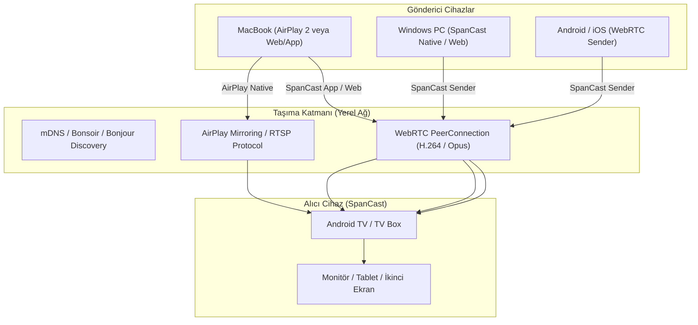

<div align="center">


# SpanCast

### Universal Ultra-Low Latency Screen Sharing & 2nd Display Ecosystem
**Extend, Mirror & Cast without Boundaries across Android TV, macOS, Windows, Linux, iOS & Web**

[](https://spancast.yasinemreturhan.com)
[](https://spancast.yasinemreturhan.com)
[](https://webrtc.org)
[](https://developer.apple.com/airplay/)
[](LICENSE)

[🌐 Web İstemci & İndirme Sitesi](https://spancast.yasinemreturhan.com) • [🚀 Kurulum](#hızlı-başlangıç) • [📐 Mimari](#mimari--teknoloji) • [📥 İndir](#indirmeler)

</div>

---

## 💡 SpanCast Nedir?

**SpanCast**, Apple AirPlay, Google Cast ve Miracast gibi tescilli ekosistem duvarlarını ortadan kaldıran, **açık kaynaklı, evrensel ve ultra-düşük gecikmeli** bir ekran paylaşımı ve sanal ikinci ekran genişletme (Desktop Spanning) çözümüdür.

Cihazınız ne olursa olsun (Android TV, Mac, Windows, iPhone veya Linux), SpanCast ile:
1. **İkinci Ekran Olarak Kullanın:** Android TV veya tabletinizi bilgisayarınızın gerçek bir 2. monitörü (Desktop Extension) yapın.
2. **Apple AirPlay 2 Alıcı:** Mac ve iPhone'dan **hiçbir ek uygulama yüklemeden** doğrudan sistem AirPlay menüsünden Android TV'nize yansıtın veya 2. ekran olarak yayınlayın.
3. **Ultra Düşük Gecikme:** WebRTC P2P donanım hızlandırmalı video pipeline'ı sayesinde 16-35 ms gecikme ile akıcı görüntü ve senkronize ses.
4. **Dahili Otomatik Güncelleme:** Uygulama içinden tek tıkla en güncel sürüme güncellenme.

---

## ✨ Temel Özellikler

- 📺 **Android TV / Google TV Optimizasyonu:**
  - Uzaktan kumanda (D-Pad) ile %100 uyumlu tam ekran receiver arayüzü.
  - Arka planda donanım hızlandırmalı H.264/VP8 video decode ve render.
- 🍏 **Gömülü AirPlay 2 Alıcı (AirPlay Server):**
  - Android cihazınız yerel ağda anında resmi bir AirPlay hedefi olarak görünür.
  - macOS "Ekranı Genişlet" seçeneğiyle doğrudan sanal 2. monitör olarak çalışır.
- ⚡ **WebRTC P2P & Sıfır Gecikme Modu:**
  - Zero-playout delay ve jitter buffer optimizasyonları ile oyun, video ve çalışma için ideal tepkisellik.
  - Sistem sesini video ile tam dudak senkronizasyonunda (AV sync) aktarma.
- 🔒 **Güvenli LAN Eşleşmesi (Zero-Knowledge PIN Proof):**
  - Ekranda dinamik QR kod ve 6 haneli PIN.
  - PIN hiçbir zaman ağ üzerinden açık metin olarak gönderilmez (HMAC-SHA256 Challenge/Response).
  - Güvenilen cihazlar için kalıcı oturum belirteci (Trust Token).
- 🔄 **Uygulama İçi Kendini Güncelleme (In-App Self-Updater):**
  - Yeni sürüm çıktığında uygulama açılışında veya manuel kontrolde otomatik bildirim.
  - APK doğrudan uygulama içinden indirilip sistem paketi kurucusu ile yüklenir.
- 🌐 **Sıfır Kurulumlu Web İstemcisi:**
  - İstemci tarafında hiçbir program kurmadan doğrudan modern tarayıcılardan (`Chrome`, `Edge`, `Safari`) ekran paylaşımı.

---

## 📥 İndirmeler & Platformlar

| Platform | Format | Durum | İndirme Linki |
|---|---|---|---|
| **Android / Android TV** | APK (v0.1.0) | Stabil | [SpanCast.apk](https://spancast.yasinemreturhan.com/SpanCast.apk) |
| **macOS (Apple Silicon & Intel)** | ZIP / App | Stabil | [SpanCast-macOS.zip](https://spancast.yasinemreturhan.com/SpanCast-macOS.zip) |
| **Windows (x64)** | ZIP / Exe | Stabil | [SpanCast-Windows-x64.zip](https://spancast.yasinemreturhan.com/SpanCast-Windows-x64.zip) |
| **Web İstemcisi** | WebRTC Client | Canlı | [spancast.yasinemreturhan.com](https://spancast.yasinemreturhan.com) |

---

## 📐 Mimari & Teknoloji



### Teknoloji Yığını

- **Frontend / TV UI:** Flutter 3.x (Material 3 Dark Theme, TV Focus Engine)
- **Video & Transport:** WebRTC (`flutter_webrtc`, LibWebRTC C++ Core), MediaProjection API, Virtual Display
- **AirPlay 2 Engine:** Gömülü Java/Kotlin AirPlay RTSP/FairPlay alıcı motoru
- **Keşif (Service Discovery):** mDNS / DNS-SD (`bonsoir` + Native Android NsdManager)
- **Web & Güncelleme Altyapısı:** Caddy v2, TLS/Let's Encrypt, Cloudflare DNS

---

## 🚀 Hızlı Başlangıç

### Geliştirme Ortamı Kurulumu

```bash
# Depoyu klonlayın
git clone https://github.com/yasinemreturhan/SpanCast.git
cd SpanCast

# Flutter bağımlılıklarını yükleyin
cd app
flutter pub get

# Testleri çalıştırın
flutter test

# Android TV / Mobil için release APK derleyin
flutter build apk --release

# macOS masaüstü uygulaması derleyin
flutter build macos --release

# Windows uygulaması derleyin
flutter build windows --release
```

---

## 🛡️ Güvenlik & Gizlilik

- **Yerel Ağ Odaklı (Local LAN First):** Tüm görüntü ve ses trafiği doğrudan yerel ağınızdaki cihazlar arasında P2P (Peer-to-Peer) olarak akar; hiçbir görüntü verisi dış sunuculara veya buluta aktarılmaz.
- **Şifreli İletişim:** WebRTC bağlantıları standart DTLS-SRTP ile uçtan uca şifrelenir.
- **Kaba Kuvvet Koruması:** Hatalı PIN denemelerine karşı hız sınırlama (rate-limiting) ve IP engelleme mevcuttur.

---

## 📄 Lisans

Bu proje [MIT Lisansı](LICENSE) kapsamında lisanslanmıştır. Detaylar için `LICENSE` dosyasına bakabilirsiniz.
